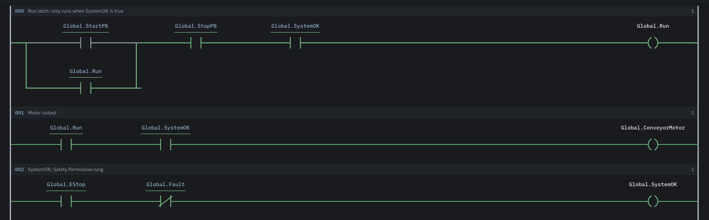
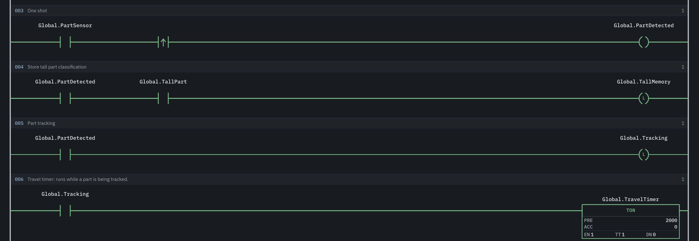
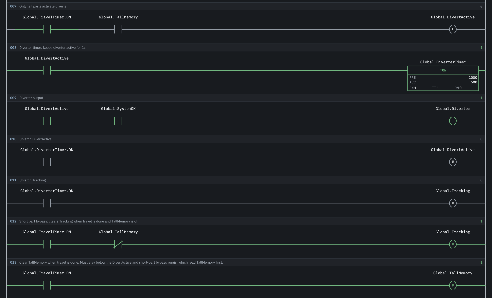
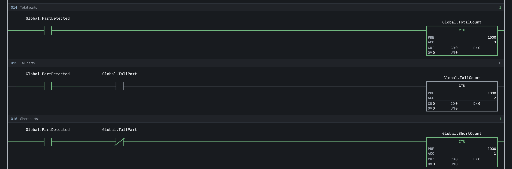
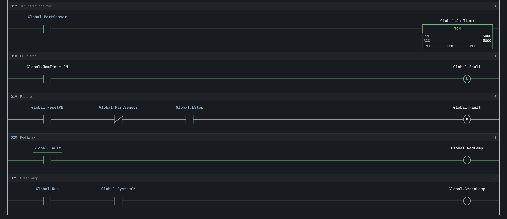

# Conveyor Sorting PLC Simulation

A ladder logic program that sorts tall parts off a conveyor, written and tested in the [FORGE](https://scancycle.net/forge) browser-based PLC simulator. It includes a start/stop run latch behind an e-stop safety permissive, part tracking with a timed diverter, part counters, and a latched jam fault with a conditional reset.

> **Modbus status:** a register map is included as a design document only. The browser simulator has no Modbus interface, so the map was designed, not tested.

## What it demonstrates

- **Safety permissive:** `SystemOK` requires a healthy e-stop and no latched fault. It gates the motor, the diverter, and the green lamp, so an e-stop or fault turns them off immediately.
- **Run latch (seal-in):** the conveyor keeps running after `StartPB` is released and stops on `StopPB`, e-stop, or fault. After any stop it needs a fresh start.
- **Fail-safe wiring convention:** `StopPB` and `EStop` read true when healthy, so a broken wire or a press drops out the run latch.
- **One-shot part detection:** a rising-edge contact makes `PartDetected` true for exactly one scan, no matter how long the sensor stays on.
- **Part tracking:** the part's classification (`TallPart`) is sampled at detection and stored in `TallMemory`. A 2 s `TravelTimer` models travel to the diverter, and only tall parts fire it, for 1 s.
- **Counters:** `TotalCount`, `TallCount`, and `ShortCount` count at detection.
- **Jam fault:** a part blocking the sensor for 5 s latches `Fault`. Reset requires `ResetPB`, a clear sensor, and a healthy e-stop.

## Program overview

22 rungs, classic scan mode, 20 ms scan time. Timer presets are in milliseconds.

| Rungs | Purpose |
|-------|---------|
| 0-2 | Run latch, motor output, and the `SystemOK` safety permissive |
| 3-13 | Part detection, classification, tracking, travel timer, and diverter sequence |
| 14-16 | Total, tall, and short counters |
| 17-21 | Jam timer, fault latch, fault reset, and the red and green lamps |

Tags: 6 inputs, 4 outputs, 7 internal bits, 3 timers, and 3 counters. See [`docs/io-table.md`](docs/io-table.md).

### Rung screenshots

**Run latch, motor output, and safety permissive** (rungs 0-2)



**Part detection and tracking** (rungs 3-6), captured on the scan where `PartDetected` is true



**Diverter sequence and cleanup** (rungs 7-13), captured mid-sequence



**Counters** (rungs 14-16), after two tall parts and one short part



**Jam fault and reset** (rungs 17-21), with the fault latched



## How to run it

1. Open FORGE in a browser and import [`logic/conveyor-sorting.json`](logic/conveyor-sorting.json).
2. Inputs are toggled by hand in the simulator. Start with `StopPB` and `EStop` true (healthy).
3. Example sequence:
   1. Pulse `StartPB`. `Run`, `ConveyorMotor`, and `GreenLamp` turn on.
   2. Set `TallPart` on, then pulse `PartSensor`. About 2 s later `Diverter` turns on for 1 s.
   3. Set `TallPart` off and pulse `PartSensor`. The diverter stays off, and `ShortCount` increments.
   4. Hold `PartSensor` on for 5 s. `Fault` latches and the red lamp turns on. Release the sensor and pulse `ResetPB` to clear it.

`TallPart` must be set before `PartSensor` goes true, because the program reads it at the moment of detection.

## Testing

[`tests/test-plan.md`](tests/test-plan.md) has 22 tests covering the run latch, e-stop behavior, part tracking, the diverter, counters, jam fault and reset, and e-stop during a diverter cycle. Each test records the precondition, action, expected result, what was actually observed, and pass or fail.

| Section | Tests | Result |
|---------|-------|--------|
| Permissives and run latch | 1-7 | All pass |
| Part tracking and diverter | 8-12 | All pass after one fix (Test 11) |
| Counters | 13-15 | All pass |
| Jam fault and reset | 16-21 | All pass |
| Output safety | 22 | Pass after one fix |

### Bugs found by testing

Two tests failed on their first run. Both are kept in the test plan as failures, with the cause, fix, and re-test noted.

- **Test 11, short part:** `Tracking` stayed on after a short part, because the only rung that turned it off depended on the diverter timer, which only runs for tall parts. This also made the next tall part divert immediately. Fixed by adding a rung that turns off `Tracking` when travel is done and the part is not tall.
- **Test 22, e-stop during a divert:** the diverter stayed on for the rest of its 1 s cycle after an e-stop, because its output rung depended on `DivertActive` alone. Fixed by adding `SystemOK` to the diverter output rung.

## Modbus register map

[`docs/modbus-register-map.md`](docs/modbus-register-map.md) describes how the program's tags would be exposed to an external client such as an HMI or SCADA system: coils for remote commands, discrete inputs for status, and input registers for counters. It is a design document that was **not tested** against a Modbus client. It also notes that the e-stop is exposed read-only by design, since a safety function should stay hardwired.

## Known limitations

- **One part in flight:** the program tracks a single part at a time. A new detection while a part is traveling overwrites the stored classification.
- **Stopping the conveyor does not pause tracking:** part detection, counting, and `TravelTimer` are not gated by `Run`, so a part keeps "traveling" and parts are still counted while the belt is stopped. A production version would gate these on the motor or clear the tracking state on stop.
- **Counters have no reset rung:** they return to 0 only when the simulator is reset.

## Repository layout

```
conveyor-sorting-plc-simulation/
├── README.md
├── logic/
│   ├── conveyor-sorting.json
│   └── rung-screenshots/
├── docs/
│   ├── io-table.md
│   └── modbus-register-map.md
└── tests/
    └── test-plan.md
```
